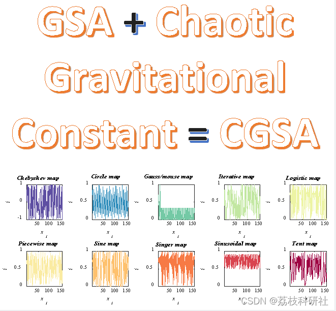
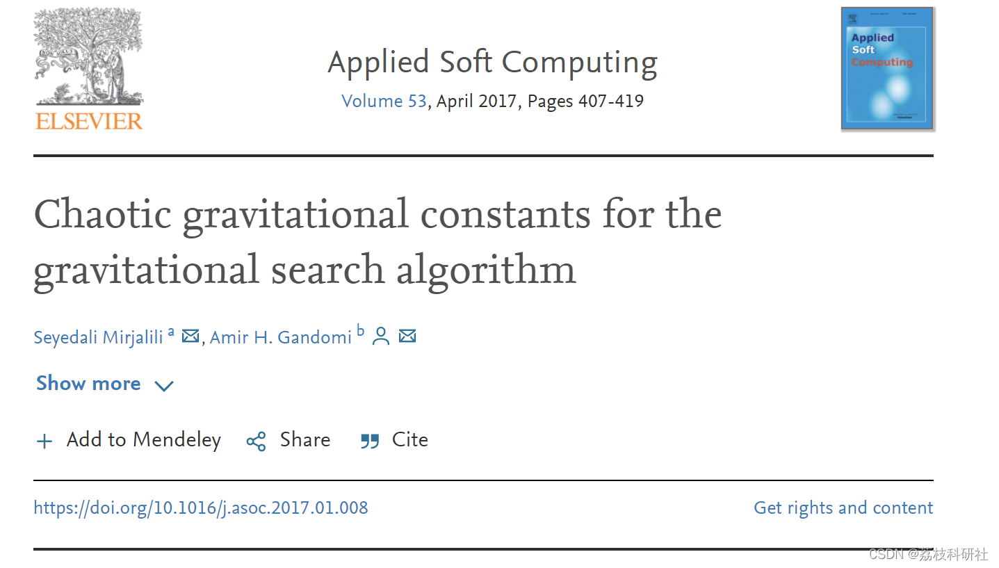
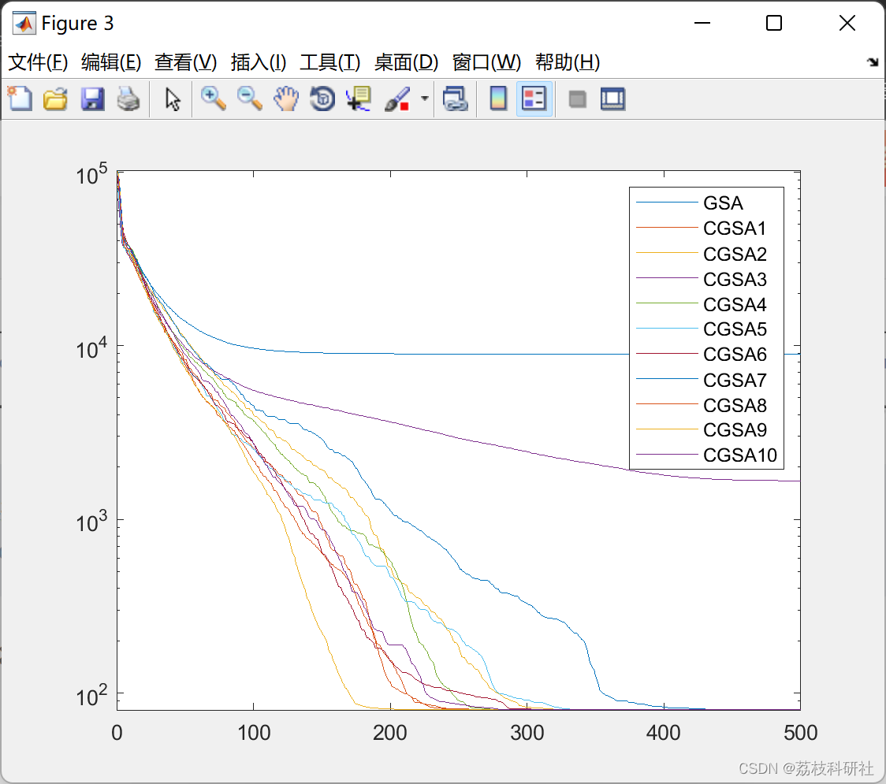
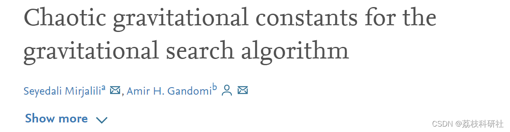

# Gravitational Search Algorithm Based on Improved Chaos Gravitational Coefficient (Matlab Code Implementation)

This paper integrates ten chaotic maps into the recently proposed population-based metaheuristic algorithm (G) for the gravitational constant (G), termed Gravitational Search Algorithm (GSA). Additionally, an adaptive normalization method that smoothly transitions from exploration to exploitation is proposed. As a case study, the performance of the proposed chaotic GSA algorithm in terms of exploration and development is evaluated using 12 offset and biased benchmark functions.
In population-based metaheuristics, the search process is divided into two main stages: exploration and exploitation. In the exploration stage, random behavior explores as broadly as possible the search space. Conversely, the rapid development of promising areas is the primary goal in the latter stage. Due to the randomness of population-based metaheuristic algorithms, finding an appropriate balance between these two stages is indeed challenging. Literature indicates that chaotic maps can improve both stages. This work integrates ten chaotic maps into the recently proposed population-based metaheuristic algorithm (G) for the gravitational constant (G), termed Gravitational Search Algorithm (GSA). At the same time, an adaptive normalization method that smoothly transitions from exploration to exploitation is proposed. As a case study, the performance of the proposed chaotic GSA algorithm in terms of exploration and development is evaluated using 12 offset and biased benchmark functions. A Wilcoxon rank sum test is conducted to assess the significance of results. The results indicate that the sinusoidal map is the best map to significantly improve the performance of the GSA.
References:
Editor
Download link: Chaotic gravitational constants for the Gravitational Search Algorithm - ScienceDirect 📚2
Run results:
clear all
P_no=30;
Max_iteration=500;
Run_no=2;
ElitistCheck=1;
All_Convergence_curves=zeros(2,Max_iteration);  
chValue=20;  
F_index = 1;  
for Algorithm_num=1:11  
for i=1:Run_no  
if Algorithm_num==1  
cg_curve=GSA(F_index,P_no,Max_iteration,ElitistCheck,Algorithm_num,chValue);  
end  
if Algorithm_num==2  
cg_curve=GSA(F_index,P_no,Max_iteration,ElitistCheck,Algorithm_num,chValue);  
end  
if Algorithm_num==3  
cg_curve=GSA(F_index,P_no,Max_iteration,ElitistCheck,Algorithm_num,chValue);  
end  
if Algorithm_num==4  
cg_curve=GSA(F_index,P_no,Max_iteration,ElitistCheck,Algorithm_num,chValue);  
end  
if Algorithm_num==5  
cg_curve=GSA(F_index,P_no,Max_iteration,ElitistCheck,Algorithm_num,chValue);  
end  
if Algorithm_num==6  
cg_curve=GSA(F_index,P_no,Max_iteration,ElitistCheck,Algorithm_num,chValue);  
end  
if Algorithm_num==7  
cg_curve=GSA(F_index,P_no,Max_iteration,ElitistCheck,Algorithm_num,chValue);  
end  
if Algorithm_num==8  
cg_curve=GSA(F_index,P_no,Max_iteration,ElitistCheck,Algorithm_num,chValue);  
end  
if Algorithm_num==9  
cg_curve=GSA(F_index,P_no,Max_iteration,ElitistCheck,Algorithm_num,chValue);  
end  
if Algorithm_num==10  
cg_curve=GSA(F_index,P_no,Max_iteration,ElitistCheck,Algorithm_num,chValue);  
end  
if Algorithm_num==11  
cg_curve=GSA(F_index,P_no,Max_iteration,ElitistCheck,Algorithm_num,chValue);  
end  
temp(i,:)=cg_curve;  
end  
All_Convergence_curves(Algorithm_num,:)=mean(temp);  
end  
figure  
for k = 1:size(All_Convergence_curves,1)  
semilogy(All_Convergence_curves(k,:))  
hold on  
end  
legend('GSA', 'CGSA1', 'CGSA2', 'CGSA3', 'CGSA4', 'CGSA5', 'CGSA6', 'CGSA7', 'CGSA8', 'CGSA9', 'CGSA10')  
save resuls  
🌈3 Matlab code implementation
🎉4 References
​  

## Images

<!-- PAYMENT_BLOCK -->

## Get this dataset

- Payment link (Stripe): [Buy now](https://buy.stripe.com/3cs8yP7sY87d0vu9AB)
- Payment QR code: 

<!-- /PAYMENT_BLOCK -->
